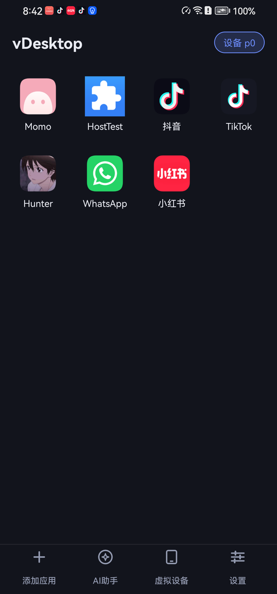
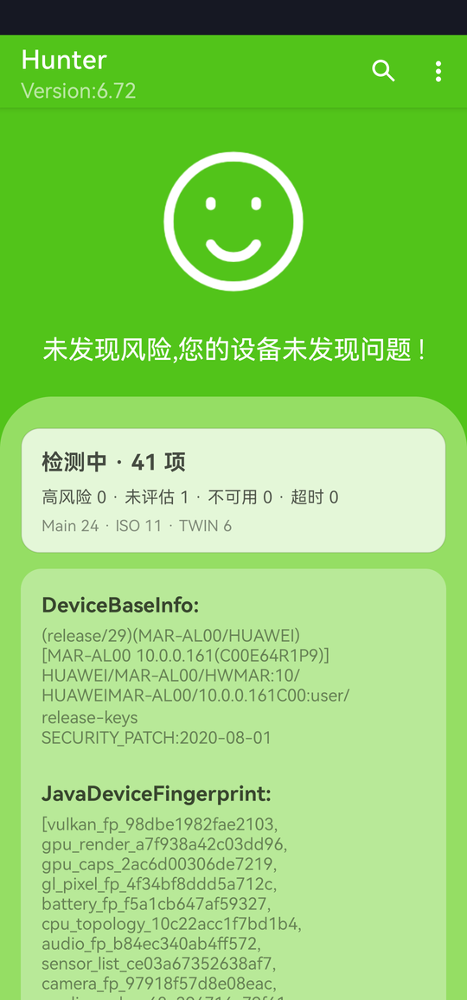
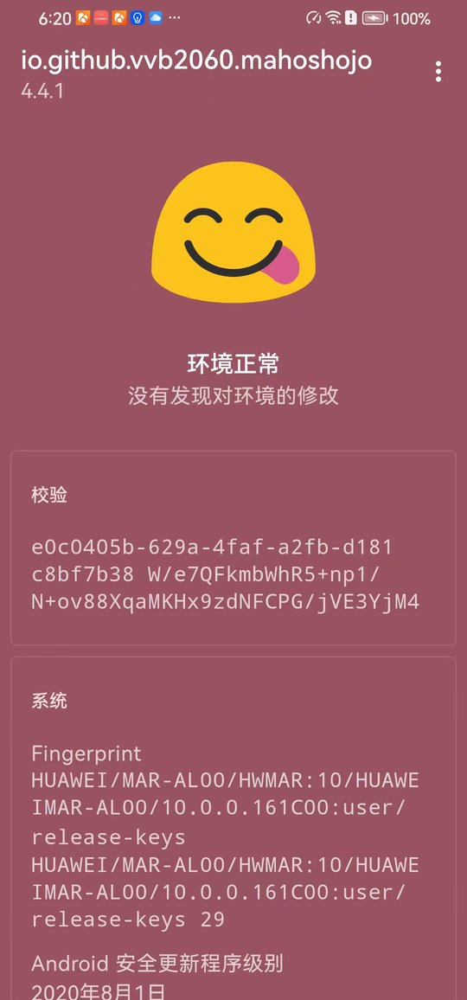
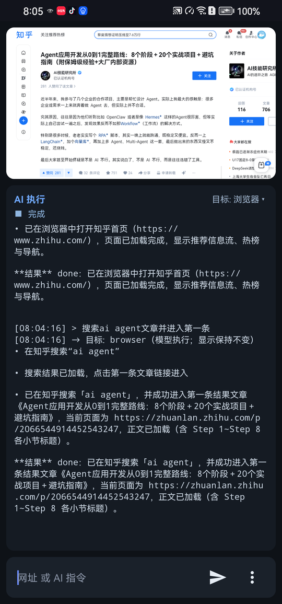
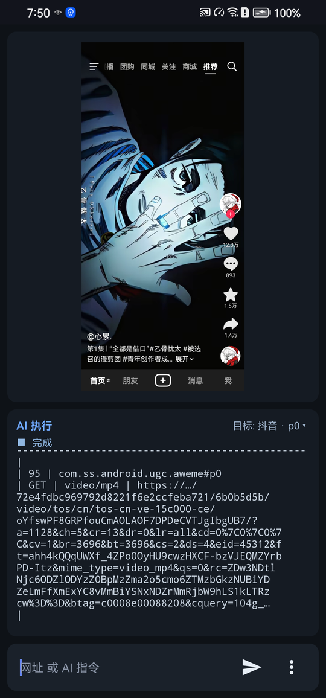
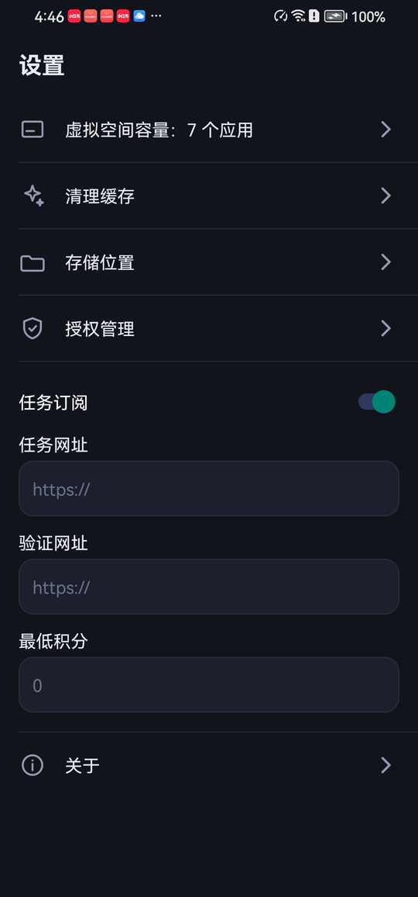
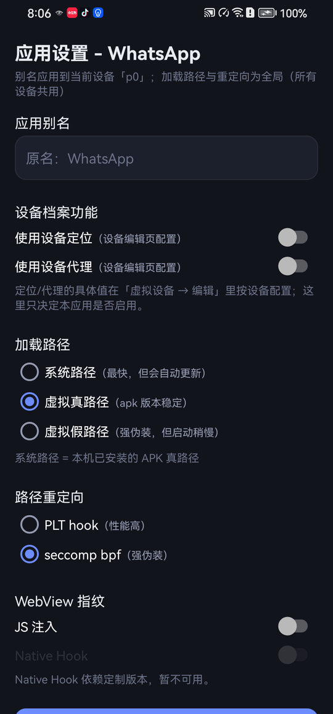
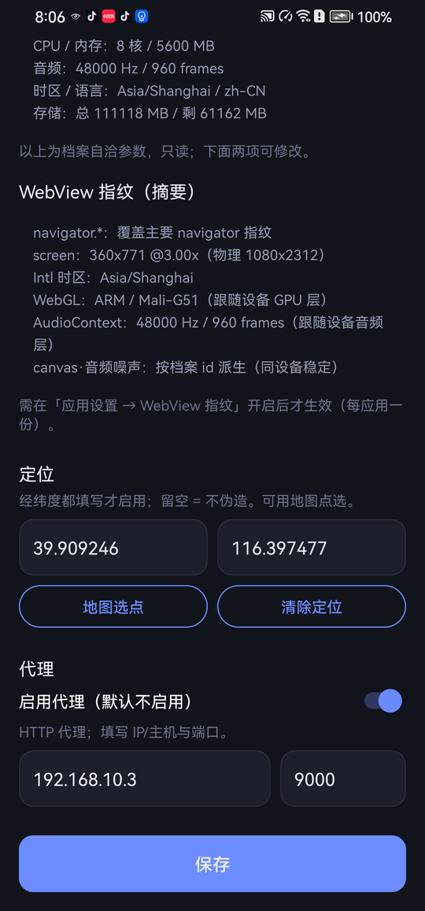

# SanBuff

English | [简体中文](README.md)

SanBuff is an on-device AI agent app built on a next-generation Android container virtualization engine. Its architecture is stealthy by nature: without any extra anti-detection patches, it passes the environment checks that mainstream detector apps and SDKs run against system-service hooking.
In agent design, SanBuff makes full use of the low-level capabilities of its process sandbox. Built-in features — including in-app traffic capture — greatly improve the agent's execution efficiency and broaden what it can do, achieving results that ordinary on-device agents cannot reach even in principle.
SanBuff also spoofs device fingerprints in both the app process and the WebView process, forming a highly self-consistent fingerprint spoofing system.

## Sandbox advantages

### 1. Lightweight

SanBuff pursues a minimal architecture and is highly self-contained at the native layer. If you don't need the agent or device-fingerprint features, integration is a single Java function call.
After symbol stripping the sandbox SDK is only 3 MB, and it shrinks further once packaged into an APK — the sample APK in this project comes out at 1.2 MB.

### 2. Stealth

SanBuff uses a stealth design that we believe is the first of its kind in the industry: even instruction-level inspection of the ART module finds no trace of a hook.

SanBuff also mimics native internal interactions as closely as possible and entirely avoids actively calling framework methods, so no anomaly shows up in the call stack — neither in the app's main process nor in service subprocesses.

Combined with a stealthy seccomp-BPF design, SanBuff naturally avoids many key checks.

In real-world testing we have progressively added dozens of anti-detection measures — soinfo in-memory field spoofing, log buffer filtering and interception, UID spoofing for isolated processes, and more.

Today it runs large apps such as TikTok and WhatsApp normally, and passes the environment checks of mainstream detector tools such as Momo and Hunter.

  
  &nbsp;&nbsp;
  

### 3. High performance

The sandbox engine virtualizes the environment by intercepting and taking over system services; no subsystem is created. Its own memory and CPU footprint stays small.
The engine supports three APK load-path configurations. With the native install path, launch speed is essentially identical to native; with a virtual "real" path, it catches up once the system has finished OAT compilation.
Loading from a virtual "fake" path gives up OAT/VDEX loading, but spoofs the APK path throughout the process's lifetime, greatly improving anti-detection.

## AI agent advantages

### 1. Deep low-level capability
Because SanBuff's agent runs inside the app process, it inherently has deeper information-collection capabilities.
The project ships with built-in in-app traffic capture that bypasses SSL pinning in most apps and fully supports HTTP/1 and HTTP/2 data collection.
For data such as comments, SanBuff reads it straight from the captured traffic rather than doing laborious UI scraping. For video, it can download to a fixed location using the captured media URLs.

### 2. Convenience

SanBuff wraps all of its low-level capabilities into script-callable skills. Facing a new site or app with no prior knowledge, it can use this rich skill set to explore that site or app deeply and carry out the user's instructions forcefully.
For scraping tasks, the AI also analyzes API endpoints from the captured traffic and then scrapes efficiently with a browser session, avoiding round after round of simulated taps and feedback.

### 3. Cost efficiency
The SanBuff agent can grow on its own. On receiving a task, it first judges whether the existing skills can support it. If not, it writes scripts on top of them and explores freely; after completing the task, it distills one or more script skills from what it did.
Next time a similar task arrives, it assembles a set of tasks and runs them automatically.
Each task has its own result validation, so execution may need no AI judgment at all — for repeated tasks, token consumption is negligible (creative tasks aside).

### 4. Observable execution
SanBuff has an AI workbench that shows task execution in real time, including the app screen currently being driven and the AI's output.
SanBuff supports multiple apps and multiple virtual devices at once (within the phone's performance limits). In practice switching between apps is inevitable, and under SanBuff's workbench display policy the app monitor automatically follows the execution target.
Besides the app view, the workbench has a built-in browser dedicated to showing web-type task execution.
That browser is built on desktop browser fingerprint spoofing, which avoids the degraded responses many sites serve to mobile clients and delivers an experience identical to a PC.

### 5. Interactivity
Beyond the AI workbench, SanBuff supports floating-window interaction, so a user who is using an app normally in full screen can still send task instructions to the agent through the floating window.

SanBuff also has a purpose-built task subscription mechanism.

A user can post a task bounty on the platform in a specified format; SanBuff polls the platform's task API, claims tasks that match the given criteria, and automatically submits evidence to the acceptance API when done.

Users can also build their own platform from the template SanBuff provides, and use the subscription mechanism to push task instructions to their own phone.

## Device fingerprints

### 1. Self-consistency

SanBuff injects fingerprints not only by overwriting low-level memory data and intercepting the relevant system services, but also by bringing the WebView renderer — which normally lives in an isolated system process — into the sandbox, further completing fingerprint editing.
Combining the two keeps the app's and the WebView's device fingerprints perfectly aligned.

  
  &nbsp;&nbsp;
  

WebView fingerprinting currently supports two modes, JS injection and native hooking. Since native hooks are tightly coupled to the WebView version and WebView updates very frequently, the porting effort would be too large — native hooking is therefore only offered in custom builds with a bundled Chromium module (bundling also inflates SanBuff's size more than 10x).

### 2. IP proxy
Beyond conventional fingerprints, SanBuff also supports location spoofing and IP proxying.
IP proxying is fine-grained down to the device: you can assign each virtual device its own proxy IP and port, whereas ordinary VPN apps only provide system-level proxying — one traffic egress per phone.

## Use cases

1. **Data isolation** — 10 virtual devices are preset and more can be added; app data is isolated per virtual device, enabling independent backup and switching of login states.
2. **App testing** — simulate different device models by editing device fingerprints, making it easy to test apps in different environments.
3. **RPA** — removes mobile RPA's dependency on adb commands and greatly simplifies RPA scripting with built-in commands; custom AI-agent development is available when needed.
4. **Remote control** — forward control commands or automation scripts through a relay server to operate apps inside the sandbox remotely.
5. **Reverse engineering** — on non-rooted phones, load frida-gadget.so through the engine for hook analysis or script injection.

## Notes

- The free edition of the engine SDK can be used freely; it currently supports Android 10 only and keeps multi-instance (multi-open) as the sole feature.
- For newer Android versions, or for add-ons such as Frida debugging and device-fingerprint editing, contact us on WeChat: `sanxiao922`.
- Follow our WeChat official account for updates: 三言说两语.
