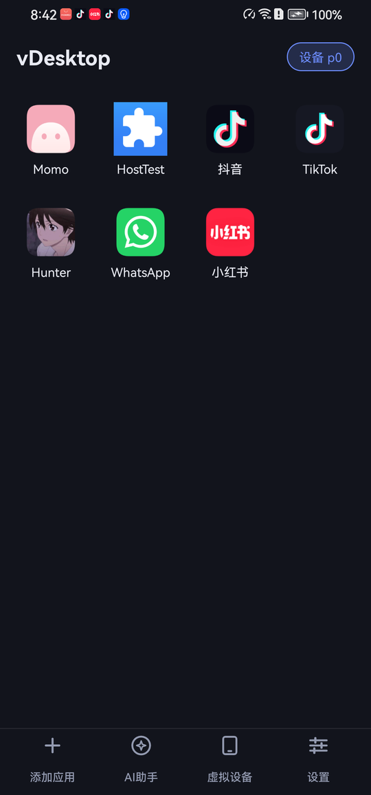
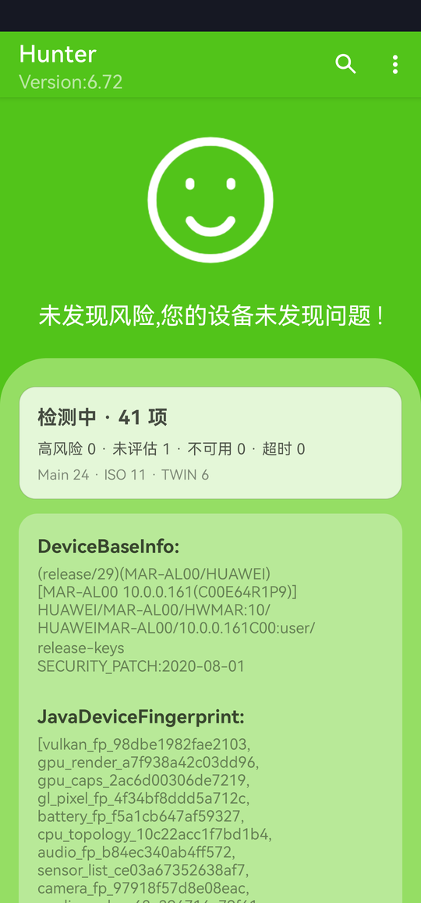
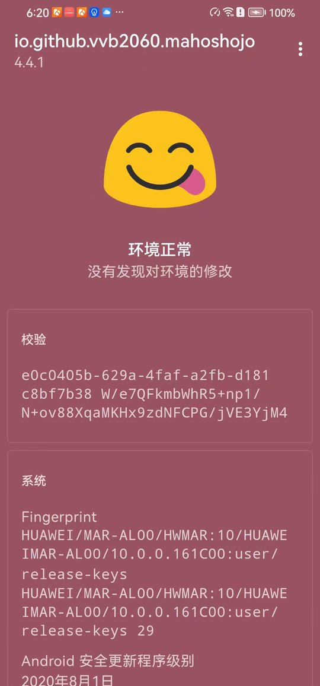
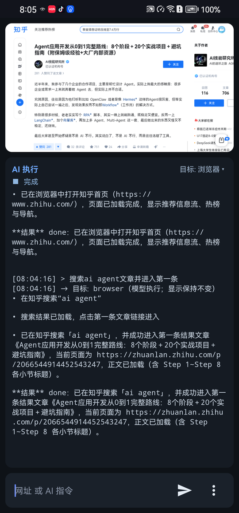
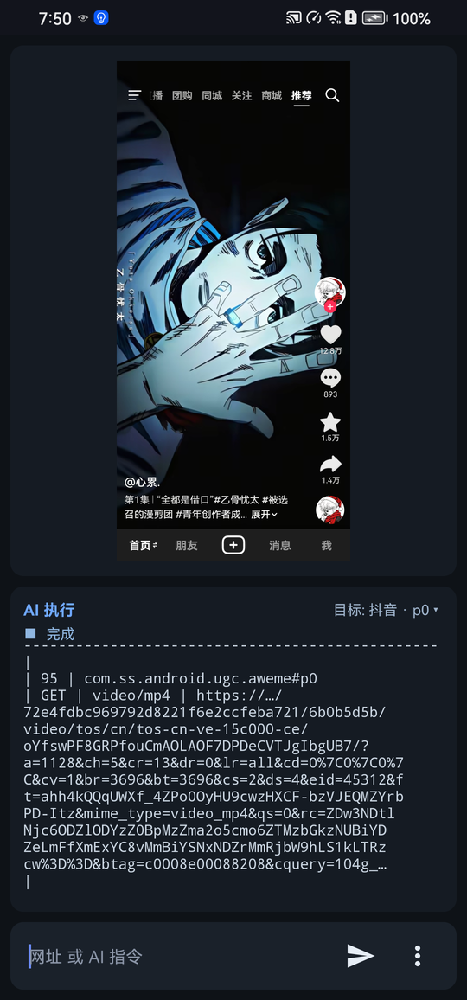
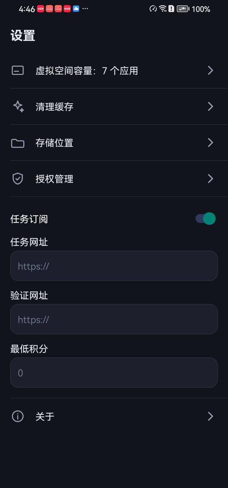
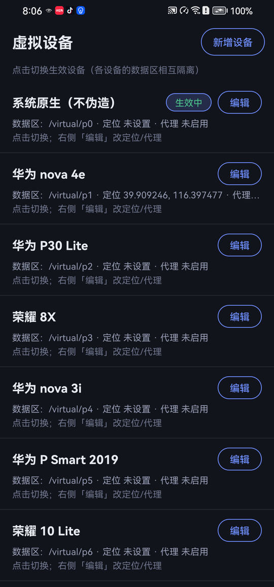
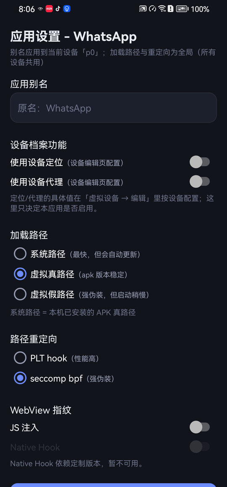
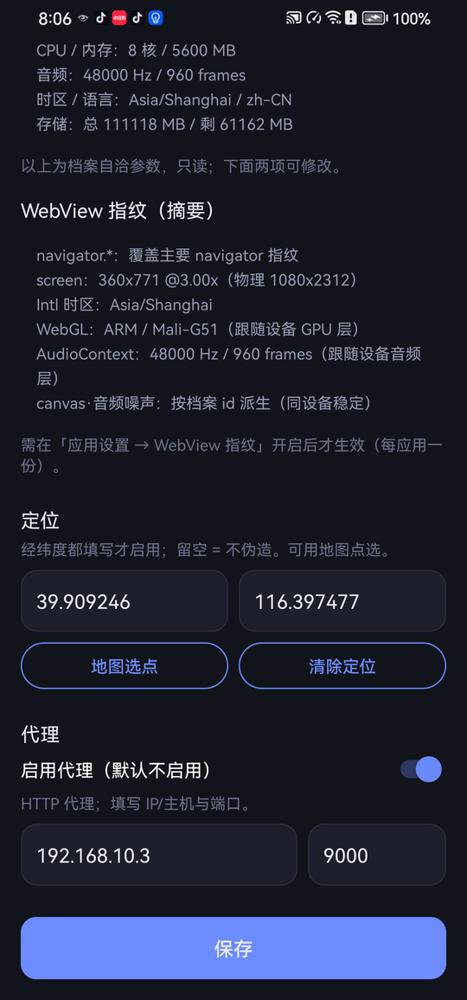

# SanBuff

[English](README.en.md) | 简体中文

SanBuff 是基于新一代 Android 应用容器虚拟化引擎打造的安卓端AI agent应用，项目具有天然的高隐蔽特性，在不额外增加反检测补丁的情况下，即可有效通过主流检测 App/SDK 针对系统服务 hook 的环境检测热点。
在智能体设计方面，SanBuff 充分利用进程沙盒的底层能力，内置了包括app抓包在内的一系列独特功能，大大提升了agent的任务执行效率和能力边界，实现了普通手机端agent从原理上就无法达成的智能效果。
另外，SanBuff还通过对app进程和webview进程的设备指纹进行双重伪造，形成了一套高度自洽的设备指纹伪造系统。

## 沙盒优势

### 1. 轻量

SanBuff 追求极致简洁的架构，实现了native层高度自洽，在不使用agent、设备指纹功能的情况下，在java层一个函数调用就能直接接入。
沙盒SDK去符号编译后仅3 MB，而在打包进apk后体积还可进一步缩小，本项目示例最终编译的 APK 仅 1.2 MB。

### 2. 隐蔽

SanBuff 采用了一种应该是业内首创的高隐蔽方案，哪怕是对art模块进行指令级检测，都不会找到任何hook痕迹。

此外，SanBuff尽可能地模拟原生的内部交互方式，完全规避了对framework方法的主动调用，无论是在应用主进程还是servcie子进程，都无法从调用栈发现任何异常。

配合高隐蔽性的seccomp bpf方案，SanBuff天然就能避开很多关键检测。

而在实际的应用测试中，SanBuff又逐步加入了soinfo 内存字段伪造、log buf过滤拦截、隔离进程uid伪造等数十项反检测手段。

现在，不仅能正常使用tiktok、whatsapp等大型应用，也顺利通过了momo、hunter等主流检测软件的环境检测。

  
  &nbsp;&nbsp;
  

### 3. 高性能

沙盒引擎通过拦截接管系统服务实现环境虚拟化，无需创建子系统；自身对内存和 CPU 的占用很小。
引挚支持三种应用apk加载路径配置，当设置成从原生安装路径加载时，应用启动速度与原生基本一致；从虚拟真实路径加载时，当系统完成oat编译后，速度也能追上原生启动。
从虚拟假路径加载，会影响oat、vdex文件的加载，但能实现对apk路径在进程中的全程伪造，大大提升反检测能力。

## AI agent优执

### 1. 底层能力强
SanBuff的agent进驻到应用进程内，天然就拥有更底层的信息收集能力。
项目内置了一套app抓包功能，可以绕开大多数应用的ssl pinning（证书绑定），完美支持http 1、http 2协议的数据收集。
对于评论之类的数据，SanBuff可以直接从抓包取出，而无需繁复的UI读取操作。对于视频，则可以按需根据采集到的视频链接下载到固定位置。

### 2. 便利

SanBuff将所有底层能力封装成可以用脚本调用的skills，面对新的网站、新的app，SanBuff在并不掌握先验知识的情况下，就能利用丰富的skills围绕用户下达的指令对新网站、app进行深入探索，强力执行任务。
对于爬虫类任务，ai还会根据抓包数据分析api接口，继而用浏览器session高效爬取数据，避免一轮又一轮的模拟点击和反馈。

### 3. 省钱
SanBuff 的agent具有自我成长能力，在接到一个任务后，agent会首先判断现有skills能否支撑任务的实施，如果不能，则基于已有skills编写脚本自由探索，完成任务后，又会根据实施过程沉淀一个或多个脚本skills。
下次接到同类任务，就会直接根据任务装配一组task，自动化实施任务。
每个task都有独立的结果校验，任务执行过程可以完全不需要AI介入判断，也就是说，对于重复任务，token的消耗微乎其微（创作型任务除外）。

### 4. 过程可感知
SanBuff有一个AI工作台，可以实时显示任务执行情况，包括当前调度的app界面、AI输出信息。
SanBuff支持同时启用多个应用（在手机性能允许范围内）、多个虚拟设备，实际场景中，肯定会存在应用切换的情况，而根据SanBuff的AI 工作台显示策略，app监视窗口会随着执行目标的变化自动切换到目标app界面。
除了app界面，工作台还内置了一个浏览器，专门用来展示网页类型的任务执行情况。
这个浏览器基于桌面浏览器指纹伪造，有效避免了很多网站在手机环境下的降级响应问题，实现了和电脑端完全一样的使用效果。

### 5. 交互性
在AI工作台之外，SanBuff还支持浮窗交互，让用户可以在正常、全屏使用app的情况下，通过浮窗向agent发起任务指令。

此外，SanBuff专门设计了一套任务订阅机制。

用户可以在平台发布指定格式的任务悬赏，而SanBuff则会轮询平台任务接口，按指定条件领取任务，完成后自动向验收接口发送证据。

当然，用户也可以用SanBuff配套提供的平台模板搭建自己的平台，利用订阅机制向自己的手机发布任务指令。

## 设备指纹

### 1. 自洽

SanBuff 不仅通过对底层内存数据的覆写、相关系统务服的拦截等方式来注入指纹，还将本来应该存在于系统隔离进程的webview渲染进程也引导进沙盒体系，进一步完善了指纹编辑。
两种方式结合，即能完美对齐app与webview的设备指纹。

  
  &nbsp;&nbsp;
  

目前，webview指纹支持js注入和native hook两种模式，考虑到native hook与webview版本密切相关，并且webview高频更新，涉及的适配工作量过大，native hook只会在内置chromium模块的定制版本中提供（主要是模块会让SanBuff体积膨胀10倍以上）。

### 2. IP代理
除常规指纹外，SanBuff还支持定位修改和ip代理。
其中，ip代理精细到设备维度，你可以为每个虚拟设备指定一个代理ip和端口，而普通的vpn软件只能提供系统级的ip代理，每个手机只能有一个流量出入口。

## 应用场景

1. **数据隔离**：实例预设 10 个虚拟设备并支持自行添加；不同虚拟设备的 App 数据相互隔离，可实现登录态的独立备份与切换。
2. **App 测试**：通过修改设备指纹模拟不同型号设备，便捷地完成 App 在不同环境下的测试。
3. **RPA**：摆脱移动端 RPA 对 adb 指令的依赖，并基于内嵌指令大幅简化 RPA 脚本编辑；必要时可提供 AI Agent 定制开发。
4. **远程控制**：通过中转服务器转发控制指令或自动化脚本，远程操作沙盒内的 App。
5. **逆向分析**：对无 root 权限的手机，可通过引擎接入 frida-gadget.so，对应用进行 hook 分析或脚本注入。

## 说明

- 本引擎 SDK 免费版本可自由使用；目前仅支持 Android 10，且仅保留多开功能。
- 如需在更高版本系统中使用，或需要 Frida 调试、设备指纹编辑等附加功能，请联系微信：`sanxiao922`。
- 项目动态请关注微信公众号：三言说两语。
